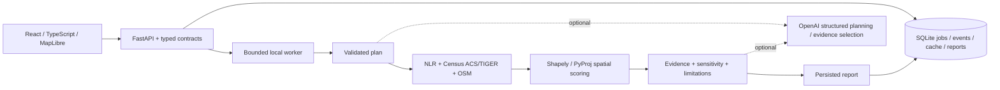

# TerraScope · SiteSignal AI

**Turn a location question into a reproducible investigation with maps, ranked opportunity areas, and evidence you can inspect.**

[](https://github.com/PeterYousefi/TerraScope/actions/workflows/ci.yml)


TerraScope is a full-stack AI engineering portfolio project. Its application, **SiteSignal AI**, investigates one concrete question: **“Where should I open an EV charging station in Austin?”** It joins public charging, demographic, boundary, and OpenStreetMap data; calculates spatial features; and produces persisted, inspectable reports. Optional OpenAI planning and evidence synthesis sit around a deterministic analysis pipeline.

[Open TerraScope](https://terrascope.azurewebsites.net) · [Azure hosting & cost](docs/AZURE.md) · [Setup & methodology](docs/LOCAL_DEVELOPMENT.md) · [Architecture](docs/ARCHITECTURE.md) · [Engineering walkthrough](docs/ENGINEERING.md) · [Validation](docs/VALIDATION.md) · [Screenshot gallery](docs/SCREENSHOTS.md)


*Actual local application capture using explicitly labeled synthetic TEST FIXTURE providers. The blank basemap keeps screenshots independent of public tile services. Values are test outputs, not Austin market findings.*

## The workflow

1. Ask the supported Austin EV charging question in the investigation workspace.
2. Follow persisted execution events as the backend retrieves and validates sources.
3. Explore ranked geographic zones, calculated score components, and linked source records.
4. Inspect the full report, compare candidates, examine weight sensitivity, and export JSON.
5. Reload an investigation from SQLite without repeating provider or AI requests.


*The acceptance scenario deliberately fails OSM to demonstrate explicit warnings and ranking with remaining dimensions.*

## Engineering decisions you can inspect

| Concern | Implementation | Evidence |
| --- | --- | --- |
| Structured AI integration | Optional Responses API tool call and schema-constrained evidence selection; validated tool order | [AI module](backend/app/ai.py) |
| Grounded output | Model selects existing observation and evidence IDs; validator rejects invented IDs and changed ranking | [AI evaluation tests](backend/tests/test_ai_evaluation.py) |
| Reproducible analysis | Projected meter-based geometry, clipped grids, demographic aggregation, normalized weighted scores, sensitivity checks | [Spatial engine](backend/app/spatial.py), [tests](backend/tests/test_spatial.py) |
| Data reliability | Typed provider normalization, timeouts, bounded retries, TTL caching, explicit partial failures | [Provider adapters](backend/app/providers.py), [tests](backend/tests/test_providers.py) |
| Execution and persistence | Bounded single-process queue, persisted events and artifacts, restart recovery, request limits | [Pipeline](backend/app/pipeline.py), [store](backend/app/store.py) |
| Full-stack delivery | Typed React API client, interactive MapLibre selection, report reload, comparison and export | [API client](lovable/src/lib/api/client.ts), [browser acceptance](lovable/e2e/workflow.spec.ts) |
| Cost control | AI disabled by default, explicit model selection, at most two bounded calls per investigation, returned token usage recorded | [Configuration](backend/app/config.py), [AI module](backend/app/ai.py) |

**The model does not calculate scores or write unrestricted factual conclusions.** Its displayed synthesis is assembled from validated, code-generated observations. The deterministic report also works with AI disabled. This is a deliberately bounded workflow rather than an autonomous general-purpose research agent.

## Architecture



**Stack:** Python, FastAPI, Pydantic, HTTPX, SQLAlchemy, SQLite, Shapely, PyProj; React 19, TypeScript, TanStack Start/Router, MapLibre, Three.js/React Three Fiber, GSAP, Tailwind; pytest, Ruff, Vitest, Playwright, GitHub Actions.

## Run locally

Requires Python 3.11+ and Node.js 22.12+ (Node 22 is used in CI).

```sh
git clone https://github.com/PeterYousefi/TerraScope.git
cd TerraScope
python3 -m venv backend/.venv
source backend/.venv/bin/activate
python -m pip install -e './backend[test]'
npm ci --prefix lovable
cp backend/.env.example backend/.env
cp lovable/.env.example lovable/.env
```

Add `NLR_API_KEY` and `CENSUS_API_KEY` to `backend/.env` for live investigations. Keep `ENABLE_OPENAI=false` for a no-AI-cost run. See [complete setup](docs/LOCAL_DEVELOPMENT.md) for Windows, source keys, configuration, limits, and troubleshooting.

```sh
# Terminal 1, with the virtual environment activated
cd backend
python -m uvicorn app.main:app --host 127.0.0.1 --port 8000
```

```sh
# Terminal 2, from the repository root
cd lovable
npm run dev -- --host 127.0.0.1 --port 5173
```

Open [the workspace](http://localhost:5173/investigate) and [interactive API docs](http://localhost:8000/docs). Missing provider credentials produce explicit setup/failure messages.

### Verify without API keys

```sh
backend/.venv/bin/python -m pytest backend/tests -q
backend/.venv/bin/ruff check backend/app backend/tests backend/live_smoke.py
cd lovable
npm test
npm run typecheck
npm run lint
npm run build
npx playwright install chromium
npm run test:e2e
```

Browser acceptance starts a real FastAPI instance with a temporary SQLite database and labeled synthetic provider fixtures. It exercises calculated results, map selection, evidence, report persistence, comparison, and connection failure. No paid model calls or provider keys are required. [Reproduce the screenshots](docs/SCREENSHOTS.md).

## Verified scope and remaining work

**Local checks on October 15, 2026:** 31 backend tests, 3 frontend tests, and 2 Chromium acceptance tests passed; Ruff, TypeScript checking, ESLint, and production build passed. ESLint reports seven warnings; the build reports large map/3D bundles. See [validation details](docs/VALIDATION.md).

- The live Austin boundary and OSM retrieval were verified on October 10; full live station/demographic ranking still requires NLR and activated Census credentials.
- OpenAI integration is covered by mocked contract/evidence tests. Paid model execution and model-quality benchmarking have not been completed.
- Opportunity scores are screening proxies, not validated demand forecasts. Land access, grid capacity, permits, utilization, and returns are unassessed. Distances are straight-line meters.
- A single-process portfolio deployment runs on Azure Free F1 at [terrascope.azurewebsites.net](https://terrascope.azurewebsites.net). Live provider keys are not configured there; [view the labeled illustrative report](https://terrascope.azurewebsites.net/investigations/austin-ev). Authentication, multi-tenant isolation, distributed workers, monitoring, and production load testing remain future work.
- The existing Lovable frontend was extended with a Python analysis backend and connected investigation flows; its cinematic landing previews remain explicitly illustrative.

The next milestone is a recorded end-to-end live run with all required sources, followed by a small versioned model evaluation set and production operational work. See the [engineering walkthrough](docs/ENGINEERING.md) for tradeoffs and a reviewer route through the code.
