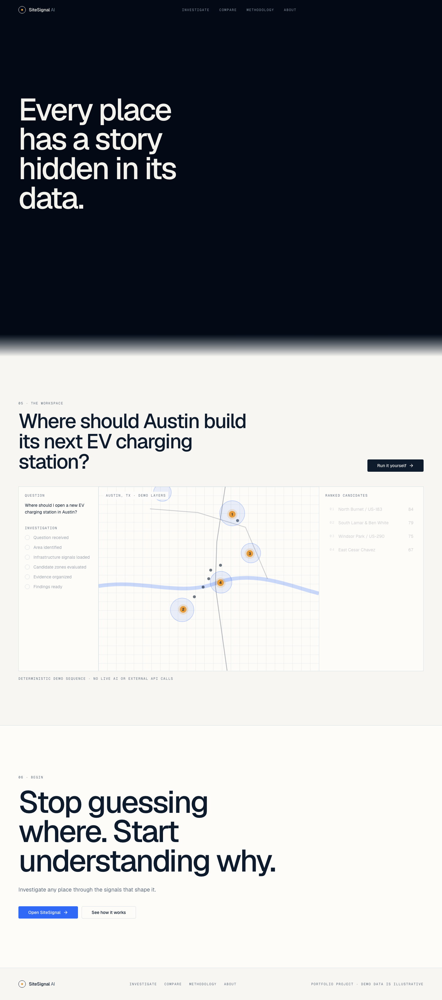
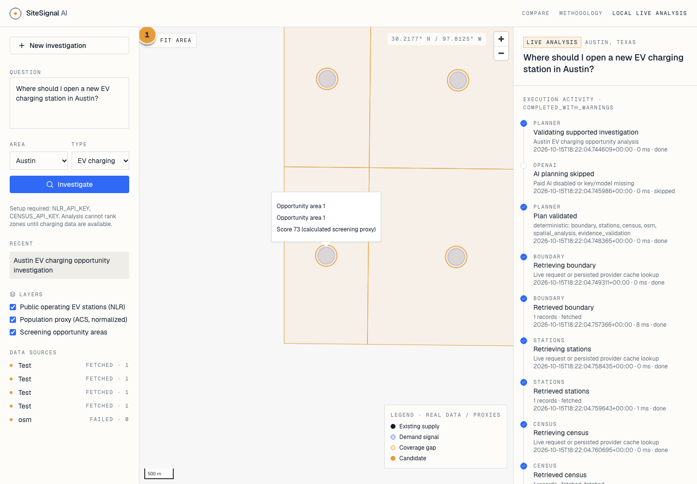
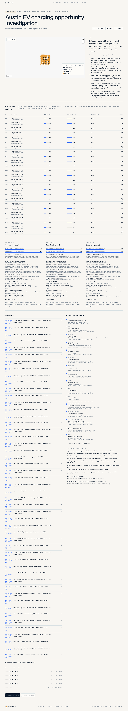
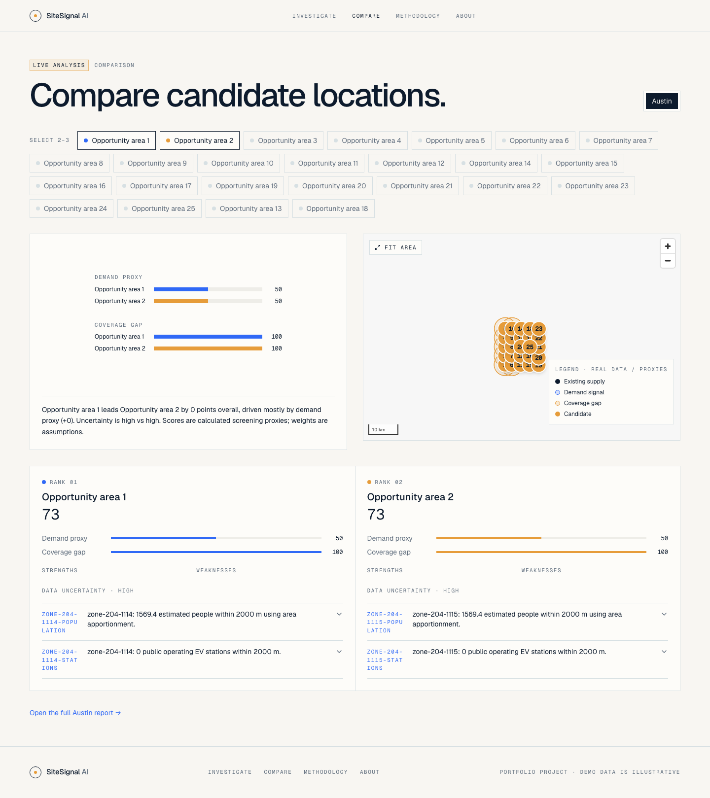
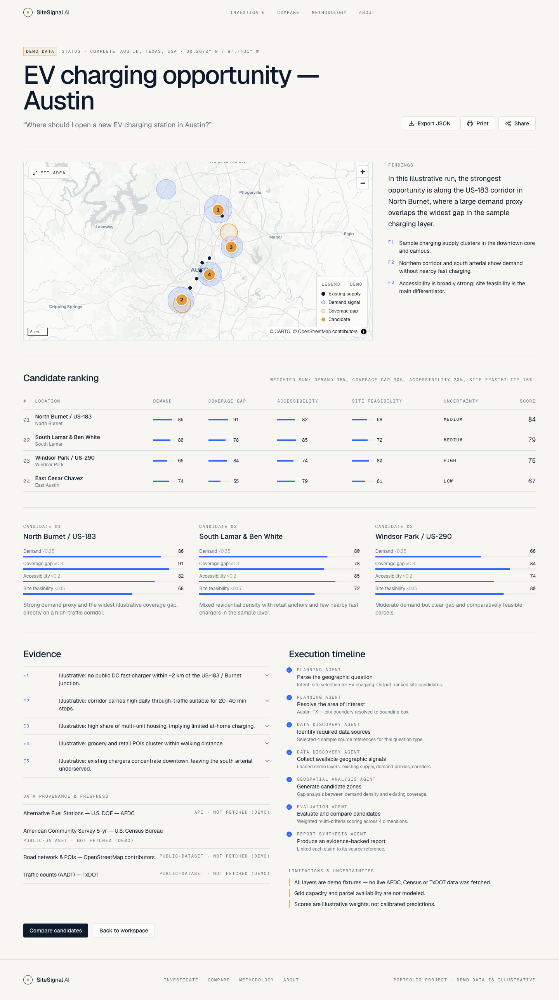

# Application screenshots

Captured from the actual local app on October 15, 2026. The connected workflow uses `backend/tests/browser_server.py` with synthetic `TEST FIXTURE` source records, a temporary SQLite database, and no paid AI calls. OSM intentionally fails to exercise reduced-data behavior. The map uses an empty background style to avoid dependence on public tile servers; candidate geometry and marker selection still execute in MapLibre. The landing page contains illustrative preview data.

## Landing



## Investigation



## Persisted report



## Comparison



## Reproduce

Install the backend and frontend dependencies from the [setup guide](LOCAL_DEVELOPMENT.md), then:

```sh
cd lovable
npx playwright install chromium
CAPTURE_DOCS=true npm run test:e2e
```

PowerShell: set `$env:CAPTURE_DOCS="true"` before running `npm run test:e2e`.

The opt-in captures reuse the asserted acceptance workflow and write to `docs/screenshots/`. Review the PNGs before committing. Routine tests do not overwrite documentation assets. Screenshots demonstrate interface behavior, not validated live Austin recommendations.

## Public Azure deployment



Captured from https://terrascope.azurewebsites.net/investigations/austin-ev on October 15, 2026. This is the application's explicitly labeled illustrative dataset, not the synthetic acceptance-test providers and not verified live market findings. Unlike routine test captures, this public screenshot uses the configured public basemap. See [Azure hosting](AZURE.md) for costs and limitations.
